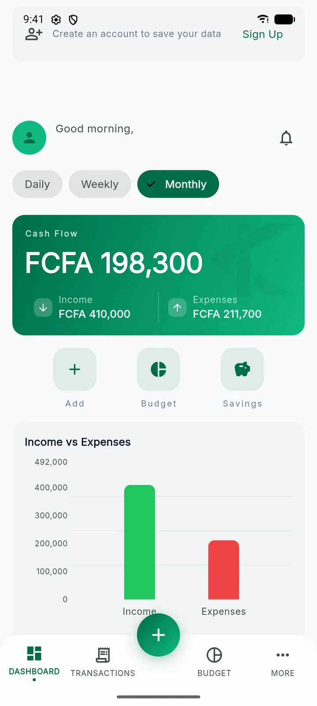
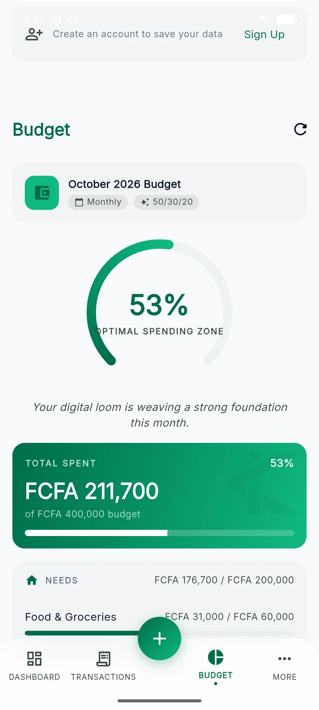
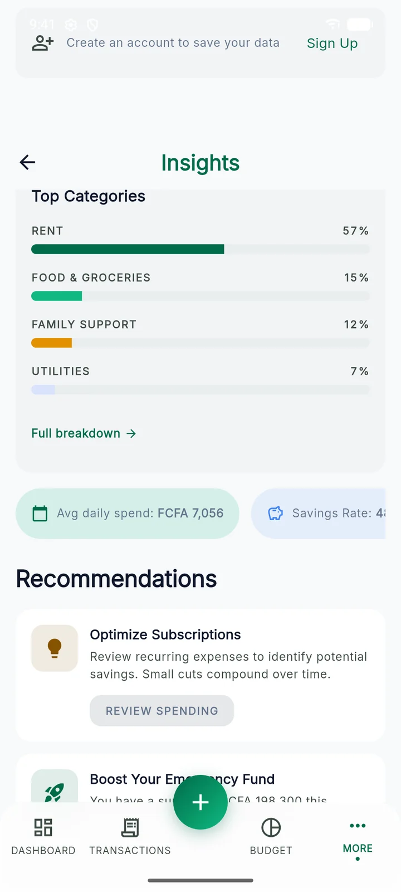

# Kalé

Offline-first personal finance app built with Flutter (Android and iOS). Track expenses and income, create budgets,
set savings goals and see where your money goes, online or offline. French first, English available.

For the project overview, see the [repository README](../README.md).

<p>
  
  
  
</p>

## Features

- **Expense and income tracking**: log transactions in seconds, with categories and mobile-money details; export to CSV
- **Budgets**: per-category budgets with date-based periods, a custom start day and local alerts at 80% and 100%
- **Savings goals**: goals, contributions and progress
- **Insights**: top categories, average daily spend, savings rate, charts (`fl_chart`)
- **Offline-first**: works without internet and syncs to Supabase when back online (Drift/SQLite and a sync queue)
- **Authentication**: every install starts as an anonymous user; email/password with OTP, Google and Apple sign-in link
  an identity without losing data
- **One base currency per account**, chosen at onboarding; amounts are stored as integer minor units
- **Local notifications**: budget alerts, optional daily reminder, savings milestones
- **Light and dark mode**: Material 3 theme with custom design tokens
- **Localization**: French (template) and English

Tontine groups and gamification exist behind feature flags and are off in v1 (see
[docs/development.md → Feature flags](docs/development.md#feature-flags)).

## Tech stack

| Layer | Technology |
|-------|-----------|
| Framework | Flutter 3.44.2, pinned with FVM (`.fvmrc`) |
| Architecture | Clean Architecture (domain/data/presentation per feature) |
| State management | Riverpod (with code generation) |
| Routing | GoRouter (auth redirects, bottom nav shell) |
| Backend | Supabase (auth, Postgres with RLS), migrations in `supabase/` |
| Local database | Drift (SQLite) with a sync queue engine |
| Models | Freezed + json_serializable |
| Error handling | `Either<Failure, T>` via dartz |

## Getting started

```bash
fvm install            # Flutter 3.44.2 from .fvmrc
make get               # install dependencies
make gen               # run code generation
make run               # run with every datasource mocked (config/mock.json): no backend needed
```

To use a real Supabase backend, copy a define file and fill it in, then run the matching target:

```bash
cp config/staging.example.json config/staging.json   # Supabase URL, anon key, Google client IDs
make run-staging
```

`make help` lists every available command. Environments, flags and Windows notes are in
[docs/development.md](docs/development.md).

## Documentation

| Topic | Doc |
|---|---|
| Architecture: layers, data flow, DI, auth, routing, errors | [docs/architecture.md](docs/architecture.md) |
| Development: FVM, environments, mock and feature flags, codegen, l10n, testing, CI | [docs/development.md](docs/development.md) |
| Deployment: release builds, signing, Supabase migrations, landing page | [docs/deployment.md](docs/deployment.md) |
| Offline-first sync and adding a syncable entity | [docs/offline_sync.md](docs/offline_sync.md) |
| Agreed product and technical decisions, v1 work plan | [docs/decisions.md](docs/decisions.md) |
| Backend schema, migrations, RLS | [supabase/README.md](supabase/README.md) |
| Design system | [docs/Kale_design/kal_modern_heritage/DESIGN.md](docs/Kale_design/kal_modern_heritage/DESIGN.md) |
| Contributing | [CONTRIBUTING.md](../CONTRIBUTING.md) |
