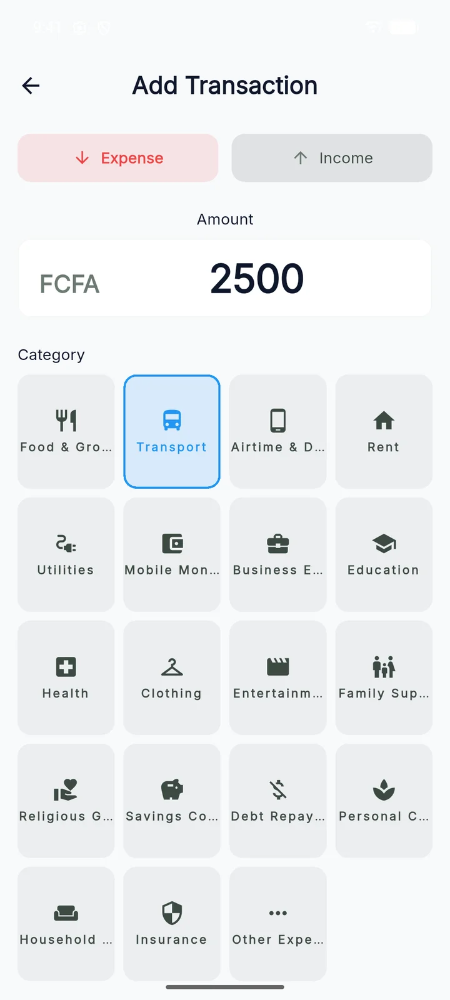
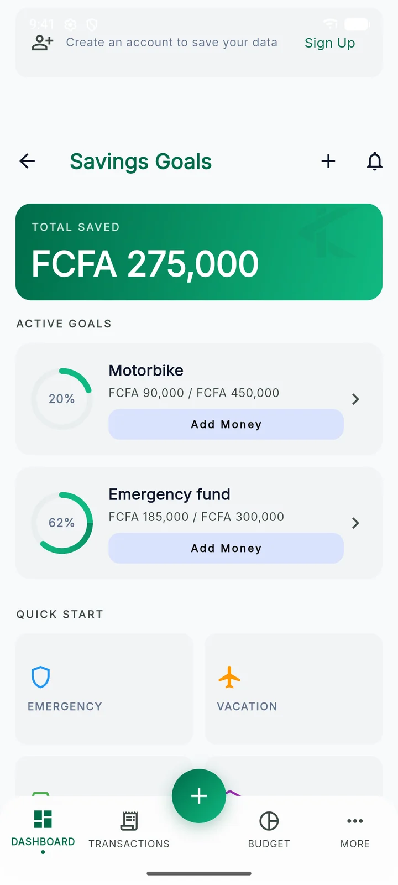

<div align="center">


# Kalé

**Offline-first personal finance app for French-speaking West Africa.**

Track income and expenses, budget per category, save towards goals and understand your spending,
even with no connection. French first, XOF and mobile money built in.

[](https://github.com/Yobson2/Kale_mobile/actions/workflows/ci.yml)


[Landing page](https://kale-landing-page.vercel.app) · [App docs](Kale/README.md) · [Architecture](Kale/docs/architecture.md) · [Contributing](CONTRIBUTING.md)

</div>

---

## Screenshots

| Dashboard | Add a transaction | Budget | Savings | Insights |
|:---:|:---:|:---:|:---:|:---:|
|  |  |  |  |  |

<sub>Captured from the Android app in mock mode (no backend), as an anonymous user.</sub>

## What it is

Kalé is a Flutter mobile app (Android and iOS) for people who manage their money in cash and mobile money, often on
a patchy connection. The phone is the source of truth: every write lands in a local SQLite database first and is
backed up to Supabase in the background whenever the network allows.

**Who it is for:** individuals in francophone West Africa (XOF/FCFA, mobile money, French UI) and, more broadly,
anyone who wants a budgeting app that keeps working offline.

## Key features

| | Feature | Details |
|---|---|---|
| 💸 | **Transactions** | Income and expenses in seconds, with categories and mobile-money provider details. CSV export through the share sheet. |
| 📊 | **Budgets** | Per-category budgets with date-based periods, a custom start day and local alerts at 80% and 100%. Optional daily reminder and savings-milestone notifications (local only). |
| 🎯 | **Savings goals** | Goals with contributions and progress tracking. |
| 📈 | **Insights** | Top categories, average daily spend, savings rate and charts (`fl_chart`). |
| 📴 | **Offline-first sync** | Writes go to Drift (SQLite) and a sync queue, then get pushed to Supabase. Restore after sign-in, pull-to-refresh, soft deletes and a visible "not backed up" state. |
| 👤 | **Try before signing up** | Every fresh install starts as an anonymous Supabase user. Later the user can link email + OTP, Google or Apple without losing data. |
| 💱 | **One base currency** | Picked at onboarding (XOF, XAF, NGN, GHS, EUR, USD and more). Money is stored as integer minor units; floats are never used. |
| 🌍 | **French and English** | French is the template language; money and dates follow the locale (`10 000 FCFA`, `13 oct. 2026`). |
| 🌗 | **Light and dark themes** | Material 3 with custom design tokens. |

Tontine (savings circles) and gamification are built behind feature flags and **switched off for v1**
([decisions](Kale/docs/decisions.md), Q5).

## Tech stack

| Area | Technology |
|---|---|
| App | Flutter 3.44.2 (pinned with FVM), Dart 3.12 |
| Architecture | Feature-first Clean Architecture (`domain` / `data` / `presentation`) |
| State and DI | Riverpod 2 with code generation |
| Navigation | GoRouter (auth redirects, `StatefulShellRoute` bottom nav) |
| Local data | Drift (SQLite) and a custom sync queue engine |
| Backend | Supabase: Auth (anonymous, email OTP, Google, Apple), Postgres with RLS, `pg_cron` jobs |
| Models and errors | Freezed, json_serializable, `Either<Failure, T>` (dartz) |
| Quality | very_good_analysis, custom_lint, riverpod_lint, mocktail, pgTAP (SQL tests) |
| CI | GitHub Actions: format, analyze, sync-wiring check, tests, Android build |
| Landing page | Next.js 16, React 19, Tailwind CSS 4, next-intl, deployed on Vercel |

## Architecture

```
┌──────────────────────── Flutter app (Kale/) ────────────────────────┐
│  Page ─▶ Notifier (Riverpod) ─▶ UseCase ─▶ Repository                │
│                                               │                      │
│                          ┌────────────────────┴─────────────┐        │
│                          ▼                                  ▼        │
│               Drift / SQLite (all reads,          SyncQueue (every   │
│               writes land here first)             mutation enqueued) │
│                                                             │        │
│        SyncEngine (push) ◀──────── SyncHandler per entity ◀─┘        │
│        SyncPuller (pull on restore / pull-to-refresh)                │
└──────────────────────────────────┬───────────────────────────────────┘
                                   │ supabase_flutter
                                   ▼
             Supabase: Auth · Postgres + RLS · pg_cron clean-up jobs
```

- UI never waits on the network. Reads come from Drift, and syncable repositories don't talk to Supabase directly;
  only the sync handlers do.
- Each feature lives in `Kale/lib/features/<feature>/`. Shared infrastructure (sync, database, money, theme,
  router, l10n) is in `Kale/lib/core/`.
- The backend schema, RLS policies and jobs are versioned as Supabase CLI migrations in `Kale/supabase/`.

Read more in [architecture.md](Kale/docs/architecture.md) and [offline_sync.md](Kale/docs/offline_sync.md).

## Repository structure

```
Kale_mobile/
├── .github/workflows/ci.yml   # CI for the Flutter app (runs in Kale/)
├── CONTRIBUTING.md
└── Kale/                      # Flutter app
    ├── lib/
    │   ├── core/              # config, database, sync, money, router, theme, l10n, widgets…
    │   ├── features/          # auth, transactions, budget, savings, dashboard, insights, onboarding…
    │   └── l10n/              # app_fr.arb (template), app_en.arb
    ├── test/                  # unit, widget and sync tests (mirrors lib/)
    ├── integration_test/      # device tests, robot pattern
    ├── supabase/              # migrations, pgTAP tests, email templates, config.toml
    ├── config/                # --dart-define-from-file environments (*.example.json, mock.json)
    ├── docs/                  # architecture, development, deployment, decisions, design system
    ├── store_listings/        # Play Store / App Store copy (fr, en)
    └── Makefile               # every dev command: `make help`
```

## Getting started

**Prerequisites:** [FVM](https://fvm.app) (Flutter 3.44.2), Android Studio or Xcode, and an emulator or device.
Docker and Node.js are only needed for the local Supabase stack.

```bash
git clone https://github.com/Yobson2/Kale_mobile.git
cd Kale_mobile/Kale
fvm install       # installs Flutter 3.44.2 from .fvmrc
make get          # flutter pub get
make gen          # build_runner code generation
make run          # every datasource mocked: no backend or secrets needed
```

`make run` uses the tracked `config/mock.json`, so you can see the whole app straight after cloning. To run against
a real backend, copy a template from `config/*.example.json` and fill it in. Windows users must enable Developer Mode
for FVM's symlinks. See [docs/development.md](Kale/docs/development.md).

### Environments

| Environment | Backend | Command |
|---|---|---|
| Mock | In-memory datasources | `make run` |
| Local | Supabase CLI stack in Docker | `make run-local` |
| Staging | Supabase staging project | `make run-staging` |
| Production | Supabase production project | `make run-prod` |

Configuration is compiled in with `--dart-define-from-file` (`BASE_URL`, `SUPABASE_ANON_KEY`, Google client IDs,
`USE_MOCK_*` flags, `FEATURE_*` flags). Only client-safe values go there. The full table is in
[development.md → Environments](Kale/docs/development.md#environments).

### Common commands

Run from `Kale/`:

| Command | Description |
|---|---|
| `make gen` | Code generation (Freezed, json_serializable, Riverpod, Drift) |
| `make l10n` | Regenerate localizations from the ARB files |
| `make analyze` | Static analysis |
| `make format` | Format all Dart files |
| `make test` | Unit and widget tests |
| `make integration` | Integration tests (needs a device) |
| `make db-start` / `make db-reset` / `make db-test` | Local Supabase stack, replay migrations, pgTAP tests |
| `make build-staging` / `make build-prod` | Staging APK / production app bundle |

## Testing

```bash
make test        # unit + widget tests, including the sync harness
make db-test     # SQL tests (RLS, triggers, jobs) against the local stack: needs Docker
```

Sync and data paths are tested end to end with `SyncHarness`: the real provider graph, an in-memory Drift database
and a fake Supabase server. Guard tests fail the build if a money field is a float, if the FR and EN translations
drift apart, or if a syncable entity isn't fully wired. CI runs everything except the SQL tests on each pull
request.

## Deployment

| Target | How |
|---|---|
| Android | `make build-staging` (APK) or `make build-prod` (app bundle), signed with `android/key.properties` |
| iOS | `flutter build ipa --dart-define-from-file=config/production.json` (no flavors yet) |
| Backend | `npx supabase db push`: staging first, then production |
| Landing page | Next.js on Vercel: https://kale-landing-page.vercel.app |

Step by step: [docs/deployment.md](Kale/docs/deployment.md).

## Known limitations

- **Pre-release.** v1 is still being built. The release bar (account deletion, Sentry, legal review) is tracked in
  [decisions.md](Kale/docs/decisions.md#work-plan-dependency-order).
- **iOS has no build flavors yet**, so staging and production share the bundle ID `com.kale.app`.
- **Crash reporting isn't wired.** `sentry_flutter` is a dependency, but only dev reporters exist.
- **Release builds fall back to debug signing** when `android/key.properties` is missing.
- **Account deletion** (a Supabase Edge Function) isn't implemented yet.
- The integration auth test is a placeholder, and CI doesn't run the SQL tests.

## Roadmap

From [decisions.md](Kale/docs/decisions.md):

- Account deletion with re-authentication, Sentry, and a strict release-signing check
- An APK-size budget enforced in CI
- Android "share SMS to Kalé" to parse mobile-money messages (first post-launch feature)
- Recurring budget templates with carry-over
- Tontine groups, after their own design session

## Documentation

| Doc | Covers |
|---|---|
| [Kale/README.md](Kale/README.md) | App overview and quick start |
| [docs/architecture.md](Kale/docs/architecture.md) | Layers, data flow, DI, auth and session, routing, errors |
| [docs/development.md](Kale/docs/development.md) | FVM, environments, flags, codegen, l10n, testing, CI |
| [docs/deployment.md](Kale/docs/deployment.md) | Release builds, signing, Supabase migrations, landing page |
| [docs/offline_sync.md](Kale/docs/offline_sync.md) | Sync engine, adding a syncable entity |
| [docs/decisions.md](Kale/docs/decisions.md) | Agreed product and technical decisions, v1 work plan |
| [supabase/README.md](Kale/supabase/README.md) | Schema, migrations, RLS, anonymous users |
| [DESIGN.md](Kale/docs/Kale_design/kal_modern_heritage/DESIGN.md) | Design system |
| [CONTRIBUTING.md](CONTRIBUTING.md) | Workflow and definition of done |

## License

No license file yet: all rights reserved by the author until one is added.
